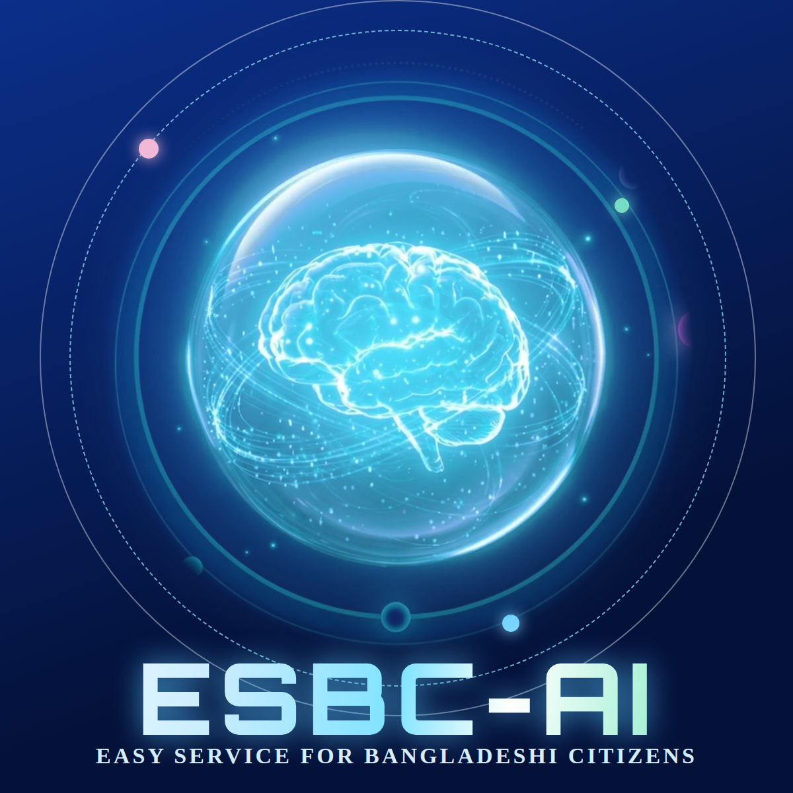

<p align="center"></p>

# ESBC-AI

**Easy Service for Bangladeshi Citizens**: a bilingual (Bangla and English), citation-grounded AI agent that helps citizens ask, prepare, pay for and track government paperwork from their phone.

> Capstone project by Farjana Ferdausi, AI & ML Engineering Bootcamp, Module-27, Batch-6, Ostad.
> It is not an official government service and is not affiliated with any government office.

**Detailed proposal page:** https://farjanaferdausi-cs50ai.github.io/esbc-ai/
**One-page proposal (PDF):** [ESBC-AI_Project_Proposal.pdf](ESBC-AI_Project_Proposal.pdf)

## The problem

Government services in Bangladesh are essential, but completing them is slow, costly and error-prone. Official information is scattered, forms are hard to fill correctly, and one typing or printing mistake can force a citizen to pay again and restart. Many people therefore depend on agent shops, brokers and lawyers. Official portals already exist, so the remaining friction is correct completion: understanding the form, matching documents and fixing errors before submission.

## The solution

ESBC-AI is a mobile-first web application that acts as an assistive layer over official services, not a replacement.

| Layer | What it does |
|---|---|
| Know | Plain-language answers with the official source and date for every claim; says "I'm not sure" when the sources do not support an answer |
| Prepare | Guided form filling, phone document scanning with a quality check, cross-document validation and a correction pathway |
| Track and Pay | Case tracking and simulated fee payment against a government-office simulator |
| Memory | Opt-in, encrypted vault that saves documents and details for reuse |

## AI approach

- Retrieval-Augmented Generation over official documents: multilingual embeddings, hybrid BM25 and dense retrieval, cross-encoder re-ranking
- Citation-constrained generation with a confidence gate and a refusal behaviour
- Plain-language rewriting of formal Bangla and English
- Document intelligence: OpenCV scan-quality checks, Tesseract OCR with a vision-LLM fallback, structured extraction with per-field confidence
- LangGraph agent with tools, checkpoints and human confirmation
- Evaluation with RAGAS on a labelled Bangla and English question set

## Tech stack

React (mobile-first), FastAPI, Pydantic, LangGraph, LangChain, Gemini, Chroma, OpenCV, Tesseract, Docker. Deployment on Vercel (frontend) and Render (backend).

## Planned repository structure

```
frontend/   React web app
backend/    FastAPI service, case database, PDF packet generation
ai/         ingestion, retrieval, agent, evaluation
docs/       AI methodology, architecture, screenshots
data/       official documents (with source URL and date checked) and synthetic test documents
```

## Status

Proposal complete. Build window: 12 to 23 October 2026. Setup instructions, usage guide and screenshots will be added here as the application is built.

## Ethics and privacy

Demo documents are synthetic. Memory is opt-in and deletable. The system gives procedural information, not legal advice.
